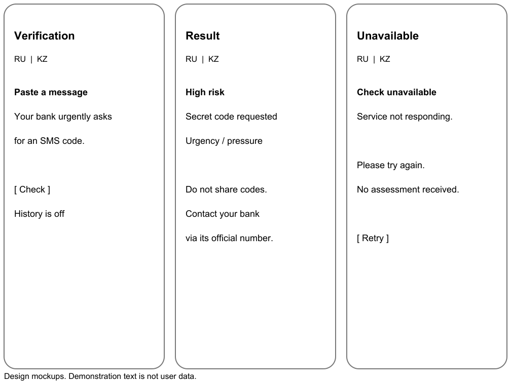

FraudShield

Development of an Application for Detecting Phishing and Fraudulent Messages

First probationary period submission materials

Software Engineering

Updated: 24 October 2026

Team:

- Nurassyl Auesbekuly Kendebaev
- Askhat Nurlanuly Amirkhanov

Supervisor: Azamat Galymzhanovich Serek, Associate Professor

The project supports manual checking of suspicious text and links, with explanations of risk indicators. This submission presents domain analysis, requirements, architecture, mockups and an evaluation plan.

Status: working draft for team and supervisor review. User interviews, verified test results and substantive supervisor feedback require actual evidence. Section 11 lists the outstanding evidence.

<!-- TOC -->

# 1 Project proposal

## Problem and target audience

A user receives a message claiming to come from a bank, delivery company or public service and must decide whether to trust its request, link or demand for urgent action. The proposed system helps assess the message before opening a link. The primary audience is mobile device users in Kazakhstan who read messages in Russian or Kazakh.

## Aim

Develop and evaluate an application prototype that accepts message text, identifies phishing and fraud indicators, examines the structure of embedded links and explains the risk in the selected interface language.

## Objectives

1. Study smishing detection approaches and limitations of available datasets.
2. Validate user needs and agree measurable requirements.
3. Prepare an anonymised corpus and annotation guidelines.
4. Implement the client, API, opt-in history and analysis module.
5. Compare rules, a simple text classifier and an extended approach.
6. Evaluate detection quality, false alarms, latency and explanation clarity.

## Scope

The MVP includes manual text entry, URL extraction without visiting links, explanations and optional check history. The main channel is a mobile web application; a Telegram Mini App is considered as a wrapper. Automatic access to SMS or private chats, call analysis, OCR, payment blocking and guarantees of message safety are outside the MVP.

## Engineering challenges and expected outcome

Challenges include combining text and URL analysis, handling two languages and mixed messages, maintaining component contracts, protecting privacy and evaluating reproducibly without data leakage. Expected outputs are an integrated prototype, repository, documentation and a report with measured results. Superiority over existing products is not claimed before testing.

# 2 Relevance and user needs validation

Official Kazakhstan materials describe phishing, fake websites and messenger fraud as current threats [10]. This establishes the problem, but does not by itself demonstrate demand for this application. Research highlights the importance of local language, context and data [1, 2, 7].

| ID | Statement | Evidence and status |
| --- | --- | --- |
| E1 | Phishing and service impersonation are current problems | Supported by official source [10]. |
| E2 | Local data matters for evaluation | Supported by research [1, 2, 7]; applicability to our corpus must be evaluated. |
| H1 | Users will manually paste messages | Hypothesis: validate in discussions and a mockup task. |
| H2 | An explanation is more useful than colour alone | Hypothesis: assess understanding of the result. |
| H3 | Telegram is preferable to a separate app | Hypothesis: ask about the preferred channel. |
| H4 | Most users need check history | Hypothesis: assess usefulness and willingness to store text. |

## User discussion plan

Before freezing requirements, conduct 3-5 discussions with audience representatives: a student, a working banking-app user, an adult with limited digital experience and, if available, a support specialist. Participation is voluntary. Do not collect passwords, verification codes, financial details or identifiable private correspondence.

Ask about the most recent suspicious message, how it was checked, difficulties, willingness to share data, preferred language and channel, interpretation of "no clear risk indicators detected" and actions after a warning. Finish with an unassisted mockup task.

For each discussion, record the date, anonymised participant code, audience category, consent, actual responses, findings and related requirements. Store records in evidence/. Record requirement changes as decisions. No actual discussion records were supplied; this item remains outstanding.

# 3 Scientific literature review

The review covers eight scientific works [1-8], mainly from 2024-2026; XLM-R [8] is retained as foundational research. Full texts were examined for problem definition, data, evaluation and limitations. Posters and preprints are explicitly labelled. Published experiments were not reproduced at this stage; implications for FraudShield are design decisions rather than measured results.

| Source | Approach and useful findings | Limitation and project implication |
| --- | --- | --- |
| [1] Cejas et al., 2026 | Multilingual embeddings for HAM, SPAM and SMISHING; local execution with latency and memory evaluation. | Private corpus; no per-language metrics or concept-drift evaluation. Evaluate language and temporal slices. |
| [2] Ali et al., 2025 | Crowdsourced local messages; zero/few-shot LLMs, per-class F1 and macro-F1. | Mozambique and Portuguese; a static time slice. Adapt the collection protocol, not the reported performance, to Kazakhstan. |
| [3] Timko, Rahman, 2024 | SmishTank: user-submitted smishing examples, brands, domains and reputation at collection time. | Contents vary by version; a phishing corpus does not supply legitimate examples. Record snapshot, date and label provenance. |
| [4] Nahapetyan et al., 2024 | Study of tactics and infrastructure; published messages and campaign groupings. | Similar campaigns can leak across splits. Group templates and domains during evaluation. |

The corpus must record source, language, date, campaign and label provenance as well as text. Foreign-language studies provide methodological guidance, but do not establish performance on Russian and Kazakh messages.

# 3 Scientific literature review continued

| Source | Approach and useful findings | Limitation and project implication |
| --- | --- | --- |
| [5] Hosseinpour, Das, 2025 | Four feature streams: regional entities, structure, CharCNN and context; comparison with individual streams. | Short poster; some spam is labelled smishing using keywords, risking dependence on label rules. Use independent annotation and ablations. |
| [6] Islam et al., 2024 | 21 extracted URL features and a CNN; explanation of feature contributions. | URL classification omits messages without links. High accuracy on the authors' split does not establish generalisation to new campaigns. |
| [7] Togmanov et al., 2025 | KazMMLU evaluates Kazakh, Russian and regional knowledge, showing model limitations. | Knowledge questions are not phishing detection. Use it to motivate language evaluation, not as fraud training data. |
| [8] Conneau et al., 2020 | XLM-R: multilingual pretraining, transfer and the trade-off between language coverage and model capacity. | General NLP benchmarks do not guarantee fraud detection. Compare quality and resources against TF-IDF on the same split. |

## Synthesis and research question

Does combined text and URL-structure analysis provide practically useful fraud detection on a local RU/KZ corpus at an acceptable false-positive rate and response time? Compare it with rules and a simple text classifier. Finding no improvement is also a valid research result.

The intended practical focus is local examples, two languages and understandable explanations. These features alone do not establish scientific novelty: multilingual and locally adapted approaches already exist [1, 2, 5].

## Additional sources

UCI SMS Spam Collection [9] supports a reproducible baseline, but spam/ham is not equivalent to fraud/legitimate. Product documentation [11-14] supports the system comparison; technology documentation [15-20] supports architecture decisions. Full references appear at the end.

# 4 Comparison of existing systems

Four systems are compared against eight common criteria using official descriptions [11-14], checked on 20 October 2026. "Not verified" means no supporting evidence was found in the reviewed source; it does not establish that a feature is absent. Products have not yet been tested on a local corpus.

| Criterion | Scamio [11] | Norton Genie [12] | VirusTotal [13] | Safe Browsing [14] |
| --- | --- | --- | --- | --- |
| Full message text | Yes | Yes | Not the service's primary input | No; URL-focused service |
| URL | Yes | Yes | Yes | Yes |
| Image / screenshot | Yes | Yes | Not verified for message explanation | Not applicable to text analysis |
| User explanation | Analysis and advice described | Yes; explains indicators | Engine and reputation reports | URL threat status |
| RU/KZ quality on local scams | Not verified | Not verified | Not verified | Does not assess text meaning |
| API for our application | Not verified | Not verified | API available; verify terms | API available; usage restrictions |
| Local processing deployment | Not verified | Not verified | Cloud service | Cloud checking |
| Comparison role | Direct functional alternative | Direct functional alternative | URL-component alternative | URL-component alternative |

## Rationale for building FraudShield

Scamio and Genie already address similar user needs. The diploma focuses on engineering and evaluating an independently developed system with a controlled corpus, RU/KZ scenarios, an explicit storage policy and reproducible baselines. Any accuracy, language or privacy advantage must be demonstrated.

Before integrating external URL services, verify pricing, terms, data transfers and API restrictions. The MVP can analyse URL structure locally without sending message text to third parties. Absence from a reputation database does not establish safety.

# 5 Technology selection

These are provisional decisions for team discussion. Finalise the stack after reviewing team skills and a short technical prototype. Planned responsibilities follow the supplied project proposals.

| Decision | Alternatives | Proposed choice and rationale |
| --- | --- | --- |
| Server API | Node.js + Express; Python + FastAPI; ASP.NET Core | Express for the user API and FastAPI for analysis fit the roles and Python ecosystem. Trade-off: two services. Consolidate in FastAPI if maintenance becomes difficult [15,16,20]. |
| Storage | PostgreSQL; SQLite; MongoDB | PostgreSQL supports user, check, version and feedback relationships; JSONB stores explanations [17]. SQLite is simpler locally; MongoDB suits documents but offers no clear advantage for this relational model. |
| Client channel | Mobile web / React; Telegram Mini App; native app | Responsive web as the main client; Telegram Mini App as a wrapper [18]. No app installation is required; evaluate Telegram authentication and platform constraints separately. |
| Text analysis | Rules; TF-IDF + logistic regression; multilingual encoder | Rules as B0, TF-IDF as B1 [19], encoder as candidate B2 [1,8]. Choose B2 based on measurements. An external LLM requires a separate consent and cost experiment. |
| Component communication | REST/JSON; gRPC; task queue | REST/JSON offers straightforward debugging and contract checks for manual MVP requests. gRPC fits stricter requirements; a queue fits long-running asynchronous jobs. |

## Reconsideration criteria

Assess integration effort, reproducible builds, latency, cost and the ability to keep private text out of external services. If two server stacks add little value, consolidate the API. Next.js is optional: SEO and server rendering are not primary requirements for the checking form.

# 6 Functional requirements

Must means required for the MVP; Should indicates the next priority. Requirements remain provisional until user discussions and supervisor approval. Acceptance criteria describe future checks, not completed tests.

| ID | Priority | Requirement | Acceptance criterion |
| --- | --- | --- | --- |
| FR1 | Must | RU/KZ text input, 1-5000 characters | Reject empty and over-limit input; accept valid Unicode strings. |
| FR2 | Must | Extract and parse links | Extract all URLs in the control set without automatically visiting or downloading sites. |
| FR3 | Must | Analysis result | Return risk_level, reasons, model_version and status. A failure returns status=unavailable, without a green result. |
| FR4 | Must | Understandable explanation | Each detected signal has an explanation and advice; absence of signals is not a safety guarantee. |
| FR5 | Must | RU/KZ interface selection | Display input controls, results, errors and guidance in the selected language; do not silently translate the original text. |
| FR6 | Must | History with explicit consent | Do not store text by default. Consented records are available only to their owner. |
| FR7 | Must | Delete a saved check | The owner can delete a record; subsequent reads return 404; prohibit access by other users. |
| FR8 | Should | Result feedback | Keep feedback separate from expert labels; do not automatically add it to training data. |
| FR9 | Must | Analysis version tracking | Saved results include algorithm version, timestamp and response schema version. |
| FR10 | Should | Telegram wrapper | If enabled, verify initData signatures server-side; reject forged or expired data. |

# 6 Non-functional requirements

| ID | Priority | Measure | Conditions and acceptance |
| --- | --- | --- | --- |
| NFR1 | Must | Local analysis p95 ≤ 2 s | 1000 requests after warm-up, 10 concurrent clients, 100-2000 characters; record CPU/RAM and versions. Not measured yet. |
| NFR2 | Must | Timeout ≤ 5 s | After timeout, display unavailability and retry; never substitute a safe result. |
| NFR3 | Must | Data minimisation | Do not store raw text without consent or write it to logs. Inspect logs and database using control strings. |
| NFR4 | Must | User isolation | Reject API reads/deletions of another user's history; keep secrets outside the repository. |
| NFR5 | Must | Reproducibility | Clean installation from lock files and README test commands; record model versions and split manifest. |
| NFR6 | Must | Quality by language | Report precision, recall, F1 and confusion matrices separately for RU and KZ; identify mixed-language messages. |
| NFR7 | Should | Interface clarity | 4 of 5 participants complete a check unassisted; report actual counts and comments without population-wide generalisation. |

## Result wording policy

Internal categories are high, suspicious and low_signal. User-facing labels are "High risk", "Suspicious indicators" and "No clear risk indicators detected". Service failures have a separate state. The original "safe" label is replaced because classification errors are unavoidable. Do not display numerical probabilities until calibration has been validated.

# 7 Architecture and use cases

## System context

Users submit text manually and receive an assessment. The team manages corpus and model versions. External URL reputation checks are optional; the default analysis does not visit links. The architecture requires no access to private chats or SMS.

[System context diagram](../diagrams/context.pdf); editable source: [context.mmd](../diagrams/context.mmd).

## Main flow UC1

The user pastes a message → the interface checks length → the API validates the request → the analyser normalises text and extracts URLs → signals are combined → an explanation is returned → the interface displays the result. Saving requires consent and an authenticated owner. A timeout produces an availability error.

# 7 Use case diagram

[Use case diagram](../diagrams/usecase.pdf); editable source: [usecase.puml](../diagrams/usecase.puml).

| Use case | Precondition | Success / exception |
| --- | --- | --- |
| UC1 Check | Text within length limits | FR1-3. A result or explicit error without a safety assessment. |
| UC2 Explanation | Completed analysis | FR4-5. The user sees indicators and next steps. |
| UC3 Save | Sign-in and explicit consent | FR6, FR9. The record belongs to the current user. |
| UC4 History and deletion | Signed-in user | FR7. Other users' records are inaccessible; deleted records cannot be read. |

Feedback FR8 is an optional action after a result. Telegram authentication FR10 applies only when the wrapper is enabled. Anonymous checks do not depend on Telegram.

# 7 Components and data

[Component diagram](../diagrams/components.pdf); editable source: [components.mmd](../diagrams/components.mmd).

| Entity | Purpose and main fields |
| --- | --- |
| User | id, auth_provider, provider_subject; avoid unnecessary profile data. |
| Check | id, user_id, created_at, risk_level, reasons_json, model_version, retention_until; store text only with separate consent. |
| Feedback | id, check_id, user_id, verdict, comment; keep user opinions separate from expert labels. |
| DatasetItem | id, sanitized_text, language, label, source, source_date, consent_or_license, campaign_group, split, annotation_version. |

Anonymous checks do not create database history. A retention period must be explicit; the provisional proposal is 30 days for opt-in history with immediate deletion available. Agree this period with the team and supervisor before implementation.

# 8 Contracts and traceability

## Draft API contract

POST /api/v1/checks/analyze

Request: text (1-5000 characters), language (ru/kk/auto). Anonymous message text is not stored.

Response 200: request_id, status=completed, risk_level, reasons[], urls[], model_version, processing_ms. Reasons contain code and description.

Errors: 422 invalid input; 429 rate limit exceeded; 503 analysis unavailable. A failure must not return risk_level=low_signal.

POST /api/v1/history: save a result with explicit consent for an authenticated user.

GET /api/v1/history: current owner's history.

DELETE /api/v1/history/{id}: delete an owned record.

POST /api/v1/feedback: optional feedback; does not automatically change the reference label.

## Requirements, components and verification

| Requirement | Component | Verification |
| --- | --- | --- |
| FR1, FR5 | Web + API | T1: empty input, length boundaries, Unicode, language switching. |
| FR2 | URL analyzer | T2: scheme-less URLs, IDN, IP, userinfo and malformed addresses; no network requests. |
| FR3, FR4, FR9 | Analyzer + UI | T3: response schema, version, reasons and service failure. |
| FR6, FR7, NFR3-4 | Auth + API + PostgreSQL | T4: consent, another user's record, deletion and no text in logs. |
| NFR1-2 | API + Analyzer | T5: load and timeout on documented hardware. |
| NFR6 | Data pipeline + evaluator | T6: fixed split; metrics by RU/KZ and class. |
| NFR7 | Web prototype | T7: tasks with 5 users and an error record. |

# 9 UX and mockups

Editable vector source: [mockups.svg](../prototype/mockups.svg). Restored from the original report; these are design mockups, not an implemented interface.

## Key interactions

The first screen explains the purpose, input limit and absence of automatic storage. Disable checking for empty input and while a request is running. Results contain a text category, specific indicators and practical advice; colour is only a supplementary cue.

The low-signal state retains: "This does not guarantee safety. Verify the sender through an official channel." Error screens do not show a green checkmark. History controls appear after sign-in; consent to history storage does not imply consent to research use.

The three static mockups cover UC1-2 and the error state. History, Kazakh localisation and Telegram sign-in require further design. Detailed interaction specifications are in prototype/wireframes.md. User validation has not yet taken place.

# 10 Verification and evaluation protocol

## Data and annotation

Planned pilot: 600 anonymised messages, 300 each for RU and KZ. Target per language: 150 fraudulent and 150 legitimate messages (300 fraudulent and 300 legitimate overall). These are collection targets, not an existing dataset. If data is insufficient, report actual coverage and uncertainty instead of replacing authentic data with generated examples.

Sources: lawfully available public corpora; voluntary anonymised examples; controlled artificial examples for unit tests, labelled as synthetic. Remove identifiers and secret codes. Retain language, date, campaign and URL signals; do not automatically open malicious links.

Use two reference classes: fraud and legitimate; uncertain cases require review. Two annotators independently label the first 100 examples, discuss disagreements and refine guidelines. Keywords and suspicious URLs are evidence for annotation, not automatic proof of the true class. Keep advertising spam separate from fraud.

## Splits and baselines

After deduplication, create approximately 60/20/20 train/validation/test splits grouped by campaigns and domains, with language balance. Copies of the same template or campaign must not cross splits. Record the seed, identifiers and configuration hash. Select thresholds on validation only. If dates permit, additionally evaluate a later time slice.

B0: deterministic text and URL rules.

B1: word/character TF-IDF with logistic regression.

B2: multilingual encoder with URL signals. Evaluate after B0/B1; compare text-only, URL-only and combined variants on the same test set.

The proposed operational protocol is detailed in tests/verification_plan.md (DIP-8): annotation and disagreement handling, campaign-grouped splits, training-only preprocessing, frozen validation thresholds, per-language metrics and uncertainty, and planned checks T1-T7. At the nominal 60/20/20 split, each language has approximately 30 fraudulent and 30 legitimate test messages; results will be pilot evidence with limited precision, not a broad performance guarantee. This protocol awaits team and supervisor review; no execution results are claimed.

# 10 Metrics and acceptance criteria

| Verification | Metric and procedure | Provisional criterion |
| --- | --- | --- |
| Detection | Fraud precision, recall and F1; macro-F1; confusion matrix, sample sizes and 95% CI; separately for RU/KZ. | Target recall ≥ 0.85 and FPR ≤ 0.10 per language. Agree thresholds; no results measured yet. |
| Uncertainty | Share of suspicious responses and coverage; compute FPR/recall across binary decisions and report the threshold. | Do not conceal difficult cases by excluding them; report abstention separately. |
| Latency | p50/p95/p99 and error rate; 1000 requests, 10 clients, local analysis, fixed CPU/RAM and versions. | NFR1: p95 ≤ 2 s; timeout ≤ 5 s. |
| Privacy and API | History isolation, deletion, no raw text in logs; HTML and instruction-injection attempts. | Mandatory T1-T4 checks pass; the analyser does not open links. |
| User flow | 5 volunteers; unassisted completion, task time and warning comprehension. | 4/5 complete a check; disclose all errors and small-sample limitations. |
| Comparison | B0/B1/B2 on the same test split; paired bootstrap for the F1 difference; document configurations. | Report actual improvement or its absence; do not import results from other studies. |

## Reporting results

Report configurations, dataset sizes and composition, threshold selection, metrics and limitations. No local quality measurements have been performed yet. If 600 examples do not provide sufficient statistical power, report wide confidence intervals and a plan to expand the corpus.

# 11 Project management and risks

| Participant | Planned responsibility | Recorded repository contribution |
| --- | --- | --- |
| Nurassyl Auesbekuly Kendebaev | Client, API, PostgreSQL, initial data collection and integration. | Initial repository and documentation commits under Kendebaev, including e332442. See merged PR #1. Substantive supervisor review remains pending. |
| Askhat Nurlanuly Amirkhanov | Text classification, URLs and domains, experiments and metrics. | Evaluation protocol (a9b3184), report alignment (bc27b60), and management records (ad92d01) under askmirkhanov-boop; merged PRs #2 and #3. These are documentation contributions, not completed experiments. |

Repository: https://github.com/Kendebaev/FraudShield

YouTrack: https://frauddetect.youtrack.cloud/issues/DIP

GitHub accounts: Kendebaev and askmirkhanov-boop.

YouTrack accounts: admin (Nurassyl) and askmirkhanov (Askhat).

## Working process

One repository serves both team members. Task IDs appear in branches and commit/PR descriptions. The current CSV records owners, expected work, acceptance criteria and priorities; task deadlines must be verified in YouTrack because they are not included in the supplied snapshot.

PRs #1, #2 and #3 were merged on 24 October 2026, and main contains their changes. No formal GitHub reviews were recorded at the readiness check. A merge is not evidence of substantive peer review; the team still needs to record actual review findings and resulting corrections. Future changes should be reviewed by another team member before merging.

The supervisor and commission need access to all materials. The current repository is publicly readable; verify reviewer access to private YouTrack resources or explicitly agree another accessible evidence route. Confirm access before submitting the form.

## Submission preparation

Before the 24 October 2026 submission deadline of 18:00, review the remaining evidence, reconcile the report, verify commission access and prepare the final attachments. The `pre-defense-1` tag identifies the first pre-defense submission snapshot. Use the PDF attachments from that same tagged version. The tag does not establish supervisor approval; after submission, it must remain fixed.

The supplied 24 October snapshot contains 15 assigned tasks: 7 for Nurassyl/admin and 8 for Askhat/askmirkhanov. There are 8 Backlog, 2 Develop and 5 Review tasks; none are marked Done. The assignments identify responsibility, not completed work. See management/README.md, management/tasks.csv and the two-page board/task PDF.

# 11 Risks and submission readiness

| Risk | Owner | Mitigation and review trigger |
| --- | --- | --- |
| Insufficient real Kazakh data | A. N. Amirkhanov | Start a pilot early; evaluate RU/KZ separately. Limit claims and expand collection when data is insufficient. |
| Template leakage across splits | A. N. Amirkhanov | Deduplicate and group campaigns/domains; manually inspect similar messages. |
| False sense of safety | Both members | Use cautious wording, a separate error state and measurement of missed fraud. |
| Disclosure of private text | N. A. Kendebaev | No storage by default; separate consent; no automatic external text analysis. |
| Complexity of two server stacks | N. A. Kendebaev | Define contracts and integration smoke checks; consolidate the API if delays arise. |
| Inaccessible submission links | N. A. Kendebaev | Verify with reviewer access; confirm permissions before submission. |

## Outstanding evidence

1. Actual records of 3-5 user discussions or a documented client agreement.
2. Substantive supervisor feedback and linked responses.
3. A documented team review of the submitted materials; no formal GitHub reviews were recorded at the readiness check.
4. Verification of task deadlines and reviewer access to the live tracker.
5. The final reviewed submission tag and confirmation that the Microsoft form has been submitted.

Repository contributions, personal task assignments and the updated screenshot PDF are now available. They do not establish completed interviews, experiments, peer review or supervisor approval. Access checks and formal submission remain unconfirmed.

# References

[1] Cejas O. A., Guo Y., Tang Q. (2026). Large-Scale Multilingual SMS Fraud Detection For Telecom Networks. NLPAICS, scientific publication.

https://aclanthology.org/2026.nlpaics-1.7/

[2] Ali F. D. M. A. et al. (2025). MOZ-Smishing: A Benchmark Dataset for Detecting Mobile Money Frauds. AfricaNLP, scientific publication.

https://aclanthology.org/2025.africanlp-1.23/

[3] Timko D., Rahman M. L. (2024). Smishing Dataset I: Phishing SMS Dataset from Smishtank.com. CODASPY, scientific publication; author version on arXiv.

https://arxiv.org/abs/2402.18430

[4] Nahapetyan A. et al. (2024). On SMS Phishing Tactics and Infrastructure. IEEE S&P, scientific publication; authors' materials.

https://github.com/wspr-ncsu/sms-phishing

[5] Hosseinpour S., Das S. (2025). POSTER: A Multi-Signal Model for Detecting Evasive Smishing. WiSec, scientific poster; author version on arXiv.

https://arxiv.org/abs/2505.18233

[6] Islam M. R. et al. (2024). PhishGuard: A Convolutional Neural Network Based Model for Detecting Phishing URLs with Explainability Analysis. Scientific preprint on arXiv.

https://arxiv.org/abs/2404.17960

[7] Togmanov M. et al. (2025). KazMMLU: Evaluating Language Models on Kazakh, Russian, and Regional Knowledge of Kazakhstan. ACL, scientific publication.

https://aclanthology.org/2025.acl-long.701/

[8] Conneau A. et al. (2020). Unsupervised Cross-lingual Representation Learning at Scale. ACL, foundational scientific publication.

https://aclanthology.org/2020.acl-main.747/

[9] UCI Machine Learning Repository (2012). SMS Spam Collection. Dataset.

https://archive.ics.uci.edu/dataset/228/sms+spam+collection

[10] Government portal of the Republic of Kazakhstan (2026). Law and order and protection of citizens' digital rights [translated title]. Official information on fraud.

https://www.gov.kz/org/aqmola-selinograd/press/news/details/1308837?lang=ru

Access and documentation check date: 20 October 2026. The first eight entries [1-8] are scientific works; the others are data, official materials and documentation. Links continue on the next page.

# References continued

[11] Bitdefender (n.d.). Scamio. Official product description.

https://www.bitdefender.com/en-sg/consumer/scamio

[12] Norton (n.d.). FAQ: Norton Genie. Official product support.

https://support.norton.com/sp/en/us/home/current/solutions/v20230717145233467

[13] VirusTotal (n.d.). How it works; Private Scanning. Official documentation.

https://docs.virustotal.com/docs/how-it-works

[14] Google (n.d.). Safe Browsing. Official documentation.

https://developers.google.com/safe-browsing

[15] FastAPI (n.d.). Features. Official documentation.

https://fastapi.tiangolo.com/features/

[16] Express (n.d.). Express web framework. Official documentation.

https://expressjs.com/

[17] PostgreSQL (n.d.). JSON Types. Official documentation.

https://www.postgresql.org/docs/current/datatype-json.html

[18] Telegram (n.d.). Telegram Mini Apps. Official documentation.

https://core.telegram.org/bots/webapps

[19] scikit-learn (n.d.). Text feature extraction. Official documentation.

https://scikit-learn.org/stable/modules/feature_extraction.html#text-feature-extraction

[20] Microsoft (n.d.). ASP.NET Core APIs overview. Official documentation.

https://learn.microsoft.com/en-us/aspnet/core/fundamentals/apis?view=aspnetcore-10.0

Additional VirusTotal privacy documentation: https://docs.virustotal.com/docs/private-scanning. Published product descriptions require practical verification; pricing and usage conditions have not been assumed.
